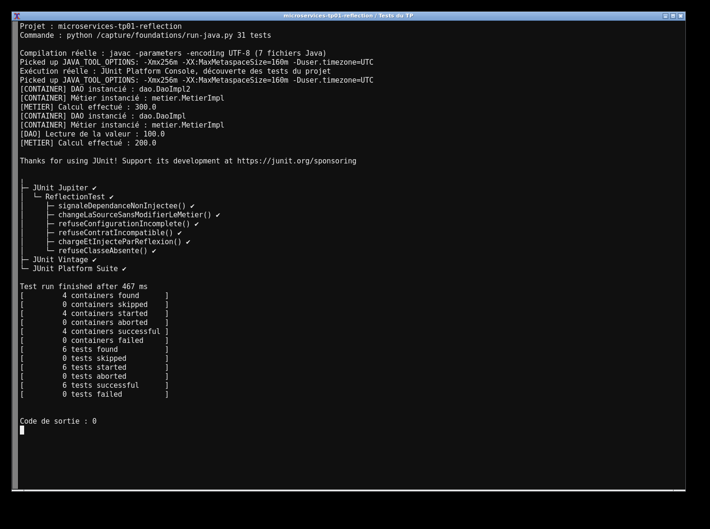

# TP1 — Réflexion Java

J'ai séparé le DAO, le métier et la présentation. `Presentation2` lit les deux noms de classes dans `config.txt`, crée les objets avec la réflexion puis appelle `setDao`. Le calcul double la valeur fournie par le DAO : 100 devient 200. Aucune classe concrète n'est utilisée dans le chargement.

J'utilise Java 17 et Maven. Pour lancer le projet :

```sh
mvn clean test
mvn exec:java
mvn exec:java -Dexec.args=config-alternative.txt
```

Le second fichier sélectionne `DaoImpl2` et donne 300 sans modifier le métier. Une configuration incomplète, une classe absente ou un contrat incorrect produit une erreur explicite.

Les captures montrent l'exécution réelle du projet et des tests sur ma machine.



